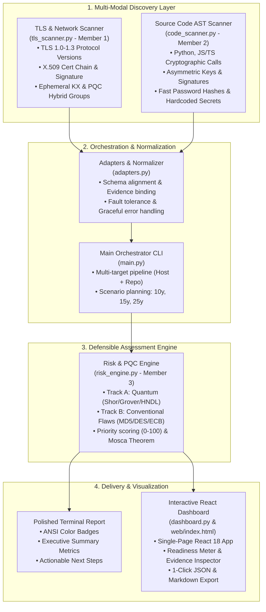

# 🛡️ Q-SHIELD: Integrated Cryptographic Post-Quantum Migration & Risk Suite

**Q-SHIELD** is an enterprise-grade cryptographic discovery, risk quantification, and post-quantum migration orchestrator. It inspects both network TLS/X.509 postures and source code ASTs, synthesizes multi-modal findings into defensible risk assessments, mathematically models quantum threats (Mosca's Theorem, Shor's and Grover's algorithms, Harvest-Now-Decrypt-Later), and provides standardized migration roadmaps (NIST FIPS 203 ML-KEM, FIPS 204 ML-DSA, FIPS 205 SLH-DSA).

---

## 🏛️ System Architecture



---

## 👥 Module Breakdown & Roles

| Module | Member / Lead | Primary Responsibilities |
| :--- | :--- | :--- |
| **`tls_scanner.py`** | Member 1 | TLS handshake analysis, X.509 certificate parsing, protocol probing, post-quantum / hybrid group detection (e.g. `X25519MLKEM768`). |
| **`code_scanner.py`** | Member 2 | AST source parsing, regex cryptographic signatures, confidence rating, distinguishing active calls vs. imports vs. comments. |
| **`risk_engine.py`** | Member 3 | Defensible threat quantification, Mosca's Theorem ($X+Y>Z$), strict separation of Quantum vs. Conventional tracks, priority scoring. |
| **`main.py` & Dashboard** | Member 4 / Integration | Multi-modal orchestration, adapter transformations, graceful network failure handling, React 18 dashboard, JSON exports, automated demo. |

---

## 🌿 Git Branch Structure

The project follows a clean git feature-branch workflow:

* `main`: Merged, production-ready integration branch containing the complete suite.
* `feature/tls-scanner`: Dedicated branch for network TLS & certificate discovery.
* `feature/code-scanner`: Dedicated branch for static source code cryptographic AST analysis.
* `feature/risk-engine`: Dedicated branch for defensible risk assessment and rulesets.
* `feature/integration-orchestrator`: Dedicated branch for `main.py`, adapters, web dashboard, tests, and demo workflow.

To view or switch branches:
```bash
git branch -a
git checkout feature/integration-orchestrator
```

---

## 🚀 Quickstart & Installation

### Requirements
* Python 3.8+ (tested on Python 3.11, 3.12, 3.14)
* `cryptography` package:
  ```bash
  pip install cryptography
  ```

---

## 💻 CLI Usage (`main.py`)

The unified orchestrator accepts a target hostname, a local repository path, or both simultaneously:

### 1. Multi-Modal Scan (Host + Code Repository)
```bash
python3 main.py --host google.com --repo sample_vulnerable_app
```

### 2. Export Structured JSON
```bash
python3 main.py --host google.com --repo sample_vulnerable_app --json scan_report.json
```

### 3. Remote TLS Scan Only
```bash
python3 main.py --host google.com --port 443 --deep
```

### 4. Local Code Scan Only
```bash
python3 main.py --repo sample_vulnerable_app --ignore-comments
```

### 5. Filter by Risk Track
```bash
# Quantum-only (Track A)
python3 main.py --repo sample_vulnerable_app --track quantum

# Conventional-only (Track B)
python3 main.py --repo sample_vulnerable_app --track conventional
```

### 6. Planning Scenarios
```bash
# Conservative (10-year CRQC Horizon)
python3 main.py --repo sample_vulnerable_app --scenario conservative

# Relaxed (25-year CRQC Horizon)
python3 main.py --repo sample_vulnerable_app --scenario relaxed
```

---

## 📊 Lightweight React Dashboard

Launch the interactive, browser-based dashboard with zero external npm/node requirements:

```bash
python3 main.py --dashboard
# OR
python3 dashboard.py
```

* **URL**: `http://localhost:8080`
* **Features**:
  * **Executive KPI Cards**: Real-time Post-Quantum Readiness Score meter, critical risk count, track counts.
  * **Interactive Target Bar**: Test remote hosts (presets: `google.com`, `badssl.com`) or local repos with 1 click.
  * **Track Separation**: Distinct tabs for Track A (Quantum Shor/Grover) and Track B (Conventional Hygiene).
  * **Evidence & Migration Modal**: Click any finding to inspect AST line snippets, certificate details, threat models, and NIST-recommended algorithms (ML-KEM, ML-DSA).
  * **1-Click JSON Export**: Download complete client-side JSON scan reports.
  * **Graceful Failure Indicators**: Non-blocking diagnostic alerts if DNS or TLS handshake fails.

---

## 🎬 Automated Demo Workflow

A reliable, reproducible demonstration workflow is provided to validate all capabilities in seconds:

```bash
./demo.sh
# OR
python3 main.py --demo
```

The demo script automatically executes:
1. **Source Code Cryptographic Analysis** on `sample_vulnerable_app`.
2. **Graceful Failure Handling** on unresolvable target `invalid-offline-target.test` (validates fault tolerance).
3. **Multi-Modal Scan** combining network telemetry and code AST into the Risk Engine.
4. **Track Separation Verification** proving separation between Post-Quantum and Conventional tracks.
5. **JSON Artifact Generation** saving `demo_report.json`.
6. **Dashboard Instructions**.

---

## 🔬 Defensible Separation of Tracks

| Dimension | Track A: Post-Quantum Cryptography | Track B: Conventional Cryptographic Hygiene |
| :--- | :--- | :--- |
| **Governing Threat** | Shor's Algorithm, Grover's Algorithm, HNDL (Harvest-Now-Decrypt-Later) | Classical brute-force, collision attacks, pattern leakage |
| **Target Algorithms** | RSA, ECDSA, ECDH, Ed25519, DH, AES-128 | MD5, SHA-1, 3DES, RC4, ECB Mode, Fast Unsalted Passwords |
| **Mathematical Basis** | Mosca's Theorem ($X + Y > Z$) against CRQC horizon | Computational complexity, Shannon diffusion, collision search |
| **Remediation Standard** | NIST FIPS 203 (ML-KEM), FIPS 204 (ML-DSA), FIPS 205 (SLH-DSA) | Argon2id (RFC 9106), AES-256-GCM, SHA-256/384/512 |
| **Defensibility Rule** | PQC **only** solves quantum vulnerabilities. | Classical flaws **cannot** be fixed by migrating to PQC. |

---

## 🧪 Unit & Integration Test Suite

Run the full automated test suite (30+ tests across risk engine, adapters, and pipeline):

```bash
python3 -m unittest test_risk_engine.py
python3 -m unittest test_integration.py
```
